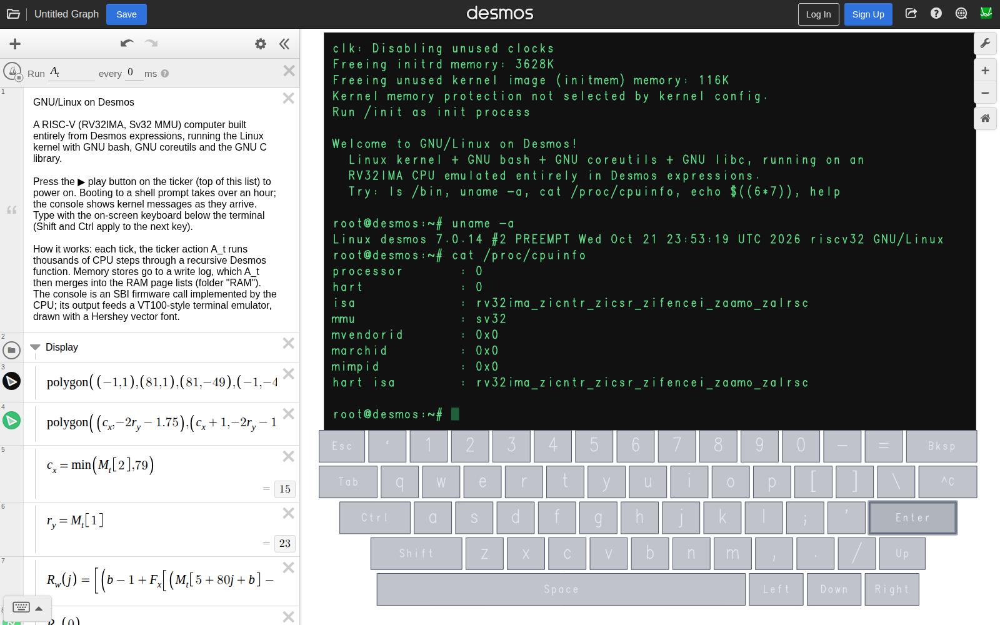

# GNU/Linux in Desmos

A Desmos graph that boots the Linux kernel to a GNU bash shell, which you type into with an on-screen
keyboard in the viewport. The computer is made entirely of ordinary Desmos expressions: a RISC-V
(RV32IMA, Sv32 MMU) CPU, 12 MB of RAM held in lists, a VT100-style terminal, and a ticker action
that drives it all. It needs nothing beyond the stock calculator at desmos.com/calculator.

It is real and it is very slow. Booting to the prompt takes about 860 ticks: around 2 h 20 min in
desktop Chrome, or 1 h 40 min in headless Chrome on an AWS m7i.xlarge. Starting a program such as
`uname -a` takes another 60 or so ticks.



[Time lapse of a full boot (46 s)](assets/timelapse.mp4): power-on, kernel messages, `/init`, the
welcome message, the bash prompt at tick 858, then `uname -a` and `cat /proc/cpuinfo` typed on the
on-screen keyboard. Each frame is a browser screenshot of desmos.com/calculator, one per tick, from
a single 2 h 28 min run. A recorder restart lost ticks 863–885, while `uname -a` was echoing.

## What runs

- **Linux 7.0.14**: a `tinyconfig` kernel plus [linux/kernel.config](linux/kernel.config), with no
  modules, the console on the SBI (`hvc0`), and the initramfs as the root filesystem.
- **GNU bash 5.2**, **GNU coreutils 9.10** (one multi-call binary) and **GNU libc**, all linked
  statically for rv32ima/ilp32.
- A tiny `/init` ([linux/init.c](linux/init.c)) that sets up a session on the console and execs bash.

## How it works

Each tick, the ticker action `A_t` runs up to four batches of up to 5000 CPU steps (`chain` × `outer`
in the image params) and then commits the results:

- **CPU** ([desmos/cpu.js](desmos/cpu.js)). One step of the RV32IMA + Sv32 machine in supervisor
  mode is a chain of Desmos functions. The batch loop is a self tail-recursive function, which
  Desmos compiles to a loop. There is no M-mode: `ecall` from the kernel is serviced directly as a
  legacy SBI v0.1 call (timer, console in/out, shutdown). A 16-entry TLB caches translations, and a
  TLB miss becomes a page walk spread over micro-steps, one PTE read per step.
- **Memory**. RAM is 768 lists `P_0…P_767` of 4096 words each. Stores within a batch go to a write
  log, and a batch ends early when the log or the output buffer fills, on `wfi`, or when a store
  would touch a page that has no free dirty-page slot. Dirty pages are tracked set-associatively: 32 sets × 2 ways, set = page mod
  32. At the end of the tick, `A_t` merges the log into each written page.
- **Terminal** ([desmos/term.js](desmos/term.js)). Console output feeds a VT100 subset (80×24,
  cursor movement, erase, scrolling) held in the list `M_t`. Each row is drawn as one point list
  through a Hershey vector font ([desmos/font.js](desmos/font.js)).
- **Keyboard**. The keys are clickable polygons whose click action appends the key's bytes to the
  input queue `Q`. Shift and Ctrl latch for the next key. The kernel reads `Q` through the SBI
  `console_getchar` call.

The expressions are generated from a small JavaScript DSL ([desmos/dsl.js](desmos/dsl.js)). It
emits Desmos LaTeX, and it also has a JS backend with Desmos semantics, used for testing. A
reference machine ([emu/machine.js](emu/machine.js)) implements exactly the same batch semantics,
and [tools/difftest.js](tools/difftest.js) checks the two against each other tick by tick.
Graph-structure choices are explained in comments throughout `desmos/`; most are workarounds for
Desmos's compiler limits (a 32768-instruction expression cap, inlining of non-recursive functions,
a 768-condition piecewise cap, and constant folding of argument-free actions).

## Running it

Build the graph (see below), then load it into a desmos.com tab with the dev server:

```sh
node tools/serve.js build 8765
```

On https://www.desmos.com/calculator, open the developer console and run:

```js
addEventListener('message', e => e.data.relay && Calc.setState(JSON.parse(e.data.text)));
open('http://127.0.0.1:8765/relay.html?f=graph.json');
```

(desmos.com's content security policy stops the page from fetching the file directly, so a relay
page fetches it and posts it back.) Then press ▶ on the ticker at the top of the expression list.
Kernel output starts at about tick 176, and the prompt appears at about tick 860.

Once the graph is loaded you can save it to your Desmos account, which gives it a shareable link.

To record a time lapse, start Chrome with `--remote-debugging-port=9333` (headless works) and run
`node tools/record.js build/graph.json build/rec/frames --cmd 'uname -a'`. It loads the graph, saves
a screenshot every 2 s, types each `--cmd` on the keyboard when bash shows a prompt, and exits after
the last one. `node tools/timelapse.js build/rec/frames out.mp4` then keeps the last screenshot of each
tick and encodes them at 30 fps (it needs `ffmpeg`).

Memory: the Desmos evaluator worker uses about 1–2.8 GB of JS heap while it runs, which fits
desktop Chrome's limit of roughly 4 GB per thread.

## Building

The kernel and userland are cross-compiled inside a Docker image that holds a Buildroot toolchain.
These steps assume a work directory `~/br` that holds the Buildroot 2026.05.3, linux-7.0.14,
bash-5.2.37 and coreutils-9.10 sources (the last three under `~/br/src/`).

```sh
P=$PWD   # this repo
docker build -t rvbuild linux/toolchain

# toolchain: rv32ima / ilp32, glibc, GCC 14
docker run --rm -v ~/br:/w -v $P:/p rvbuild sh -c \
  'cd /w/buildroot-2026.05.3 && make O=/w/out BR2_DEFCONFIG=/p/linux/toolchain/buildroot.defconfig defconfig && make O=/w/out toolchain'

docker run --rm -v ~/br:/w -v $P:/p rvbuild /p/linux/build-kernel.sh     # -> ~/br/kbuild/arch/riscv/boot/Image
docker run --rm -v ~/br:/w -v $P:/p rvbuild /p/linux/build-userland.sh   # bash, coreutils, init
docker run --rm -v ~/br:/w -v $P:/p rvbuild /p/linux/mkinitramfs.sh      # -> ~/br/initramfs.cpio

# lay out the 12 MB RAM image (kernel, initramfs, device tree) and the CPU parameters
node tools/mkimage.js --kernel ~/br/kbuild/arch/riscv/boot/Image --initrd ~/br/initramfs.cpio \
  --ram 12M --out build/k7 --log-max 9400 --chain 5000 --outer 4

# generate the Desmos graph state (about 12 MB, 1007 expressions)
node tools/build.js build/k7/image.json build/graph.json
```

## Testing

```sh
node emu/boot.js build/k7/image.json                      # boot the reference machine; console on stdout
node emu/boot.js build/k7/image.json --input 'uname -a\n'
node --stack-size=60000 tools/difftest.js build/k7/image.json --ticks 3000 --chain 1000 --outer 20
node --stack-size=60000 tools/stepdiff.js build/k7/image.json --tick 273   # locate a divergence step by step
node tools/termtest.js                                    # terminal emulator vs a JS model
```

`difftest` runs the generated Desmos CPU (through the DSL's JS backend) side by side with the
reference machine. Its last full run matched for 3000 ticks and 31.6M steps, through to the bash
prompt.

## Layout

| Path | Contents |
| --- | --- |
| `desmos/` | expression DSL, CPU, terminal, font, and graph assembly |
| `emu/` | reference machine and console boot runner |
| `linux/` | kernel config, device tree, `/init`, rootfs files, build scripts, toolchain |
| `tools/` | image layout, graph build, diff tests, dev server, time-lapse recorder |
| `assets/` | Hershey font, icon, screenshot, time lapse |

The Hershey font is used with attribution; see [assets/font/README](assets/font/README).
